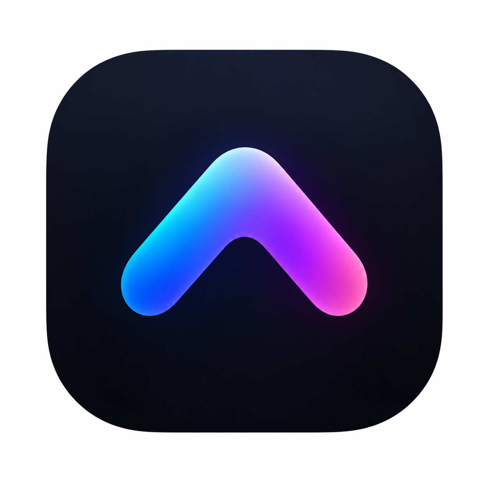

<p align="center">
  
</p>

<h1 align="center">TopNotch</h1>

<p align="center">
  A native macOS app that turns the MacBook notch into a live, interactive island:<br>
  now playing (including YouTube in the browser), volume and brightness HUDs, calendar, battery, Bluetooth and Focus alerts.
</p>

<p align="center">
  
  
  
  
</p>

---

## About

TopNotch lives in the notch at the top of your display. When nothing is happening it stays the same black shape as the camera housing. When something happens, it grows into small "ears" on either side of the notch, briefly peeks out with details, or expands into a full panel you can interact with.

It is modeled on [Alcove](https://tryalcove.com). The [Alcove analysis](ALCOVE_REVERSE_ENGINEERING.md) informed this independent implementation, which contains none of Alcove's code or assets. It is written in Swift with SwiftUI and AppKit, builds with the command-line tools alone, and has no third-party dependencies.

## Features

### The notch
- A black notch that animates between idle, compact activities, alerts, quick peeks and an expanded panel, with springy open and settled close animations.
- **Follows the system theme.** The closed notch stays black to blend with the hardware. In Light mode the expanded panel becomes a light, frosted surface with dark text; in Dark mode it stays black.
- Click to expand, or turn on hover expansion with an adjustable delay. It collapses when the pointer leaves.
- Two-finger swipes over the notch open and close it, skip tracks, and cycle or dismiss activities. Right-click for media, calendar and Settings actions.
- Displays without a notch get a simulated one with adjustable width and height. Choose the built-in display, main display, a specific display or all displays.
- Hides in full-screen apps, games, Mission Control and screen recordings when you want it to.

### Now Playing
- **Any app, including browsers.** The System source follows whatever macOS reports as playing: YouTube or SoundCloud in Chrome, Brave or Safari, podcast apps, Music, Spotify and more.
- When the source is set to **Music** or **Spotify**, that app takes priority, and browser or other playback appears whenever it isn't playing. Pausing a video keeps it on screen instead of jumping back to the paused music app.
- Artwork, title and artist, a draggable progress bar, play/pause, next and previous, plus an optional shuffle, repeat or copy-link button.
- Artwork-tinted waveform in the compact view, artwork color, accent, gradient or monochrome styling, and a quick peek when the track changes.
- Option to strip "(Remastered)", "(Official Video)" and similar extras from titles.

### Volume and brightness HUDs
- With Accessibility permission, TopNotch handles the volume, mute and brightness keys itself and **replaces Apple's on-screen HUD** with one inside the notch.
- Hold Option + Shift for fine steps. Shows the output device (AirPods, speakers) and an optional percentage. Bar style and animation speed are configurable.
- Changes made elsewhere (Control Center, the menu bar) also show a notch HUD.

### Alerts
- Charging, low battery and Low Power Mode.
- Bluetooth connections and disconnections, with AirPods battery levels.
- Focus mode changes, with the mode name.

### Calendar
- Today and tomorrow in a week strip or month view, with calendar colors and per-calendar filters.
- Join buttons for Zoom, Google Meet, Microsoft Teams and Webex links.
- Reminders before and at the start of events, time to leave, an hourly chime, and weather on days with no events.

### Settings
- Organized like Alcove's: General, Notifications, Live Activities, Lock Screen and About, with a first-launch welcome window.
- On first launch TopNotch copies matching settings from an installed Alcove.

See [FEATURE_PARITY.md](FEATURE_PARITY.md) for what differs from Alcove and what has been verified.

## Requirements

- macOS 15 or newer (tested on macOS 26).
- Apple command-line tools (Swift and clang). Full Xcode is not required.

## Build and run

```sh
./scripts/build-app.sh
open dist/TopNotch.app
```

The script builds a release binary and assembles `dist/TopNotch.app`, including `libTopNotchMedia.dylib`, the helper that reads the system now-playing state.

### Keeping permissions across rebuilds

macOS ties Accessibility permission to the app's code signature. An ad-hoc signature changes on every build, so the permission silently stops applying after a rebuild even though the switch in System Settings still looks on.

If a keychain at `~/Library/Keychains/topnotch-signing.keychain-db` contains a code-signing identity named **TopNotch Local Signing**, the build script signs with it so the permission survives rebuilds. Without it, the script falls back to ad-hoc signing. To make one:

```sh
KC=~/Library/Keychains/topnotch-signing.keychain-db
security create-keychain -p topnotch-local "$KC"
security set-keychain-settings "$KC"
# Create a self-signed certificate with the codeSigning extended key usage, export it as id.p12, then:
security import id.p12 -k "$KC" -P <p12-password> -T /usr/bin/codesign
security set-key-partition-list -S apple-tool:,apple:,codesign: -s -k topnotch-local "$KC"
security list-keychains -d user -s $(security list-keychains -d user | tr -d '"') "$KC"
```

To distribute TopNotch to other Macs, sign and notarize it with your own Developer ID.

## Permissions

| Permission | Used for |
|---|---|
| Accessibility | Handling the volume and brightness keys and hiding Apple's HUD |
| Automation (Music, Spotify) | Reading and controlling those apps when chosen as the source |
| Calendars | Showing events, reminders and Join buttons |
| Location (optional) | Weather on empty days and time to leave |

If the Accessibility prompt keeps appearing after a rebuild, remove TopNotch from **System Settings → Privacy & Security → Accessibility** with "−" and add `dist/TopNotch.app` again.

## How it works

- **Notch window:** one borderless, non-activating panel per display, above the menu bar, hosting a SwiftUI view. The notch is a custom shape whose size animates between states.
- **Now Playing:** since macOS 15.4, MediaRemote only answers Apple-signed processes. TopNotch runs a small helper (`Helper/MediaRemoteBridge.m`) inside Apple's `/usr/bin/perl`, which streams the now-playing state as JSON lines and accepts playback commands. Music and Spotify can also be read directly with AppleScript.
- **Media keys:** a session event tap intercepts the system-defined key events for volume and brightness and drives CoreAudio and DisplayServices itself.

## Project layout

```
Sources/TopNotch/
  main.swift            App delegate, notch panels, pointer tracking, gestures
  TopNotchModel.swift   App state: activities, alerts, HUDs, calendar, media
  Views.swift           Notch shape and all notch views
  MediaService.swift    Now playing: system bridge and Music/Spotify sources
  MediaKeyTap.swift     Volume and brightness key interception
  Services.swift        Audio, battery, Bluetooth, Focus, calendar, permissions
  WeatherService.swift  Open-Meteo weather
  Preferences.swift     Settings storage
  SettingsView.swift    Settings and welcome windows
Helper/MediaRemoteBridge.m   Now-playing helper library
Resources/                   Info.plist and the helper launcher
scripts/build-app.sh         Builds and signs dist/TopNotch.app
```

## Privacy

TopNotch has no server component and no analytics. Battery, audio, display, Bluetooth, Focus and calendar data are read locally. The System media source runs a small helper inside Apple's `/usr/bin/perl` because macOS only lets Apple-signed processes read MediaRemote; the helper exits with TopNotch. Weather sends approximate coordinates to Open-Meteo, and time to leave asks Apple Maps for travel times; leave those features off to avoid the requests. TopNotch does not capture audio or screen contents.
